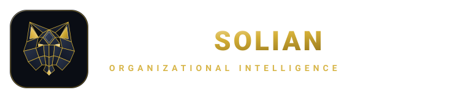

# AUREN SOLIAN — Organizational Intelligence Platform



> **Enterprise AI Assistant, Corporate Knowledge Vault & Autonomous Operations Platform**

---

## 1. Overview & Identity

**Product Name:** AUREN SOLIAN  
**Product Type:** Company AI and Organizational Intelligence Platform  
**Visual Foundation:** Obsidian & Graphite dark base (`#0B0D13`, `#11151F`) with restrained Champagne-Gold accents (`#D4AF37`, `#F7E7B4`).  
**Wolf Emblem:** Minimalist, geometric, symmetrical wolf head representing disciplined leadership, executive intelligence, and strategic precision.

AUREN SOLIAN is an independent company AI platform engineered for high-trust organizational operations, executive oversight, institutional memory indexing, and role-governed task automation.

---

## 2. Platform Architecture

AUREN SOLIAN is structured into modular organizational foundations:

| Module | Purpose & Capabilities |
| :--- | :--- |
| **Executive Dashboard** | Real-time operational velocity, cross-departmental KPIs, active initiatives, and AI activity telemetry. |
| **Company AI Assistant** | Streaming SSE assistant with institutional knowledge injection, decision reasoning, and action proposals. |
| **Knowledge Vault** | Structured corporate memory: Standard Operating Procedures (SOPs), compliance rules, and playbooks. |
| **Staff & Teams Directory** | Multi-tier Role-Based Access Control (**Owner**, **Admin**, **Manager**, **Member**, **Guest**). |
| **Projects & Roadmaps** | Enterprise initiatives, milestone tracking, resource allocations, and progress indicators. |
| **Tasks & Operations** | Operational backlog and Kanban columns (Backlog, In Execution, Executive Review, Completed). |
| **Client Accounts (CRM)** | Commercial partner registry, account managers, contract valuations, and status tracking. |
| **Corporate Documents** | Encrypted document repository with security classification tiers (Public, Internal, Confidential, Restricted). |
| **Reports & Analytics** | Operations velocity, SOP retrieval efficiency, and institutional AI query metrics. |
| **Business Workflows** | Autonomous decision triggers, incident escalation routines, and recurring executive briefings. |

---

## 3. Engineering Stack

- **Frontend:** React 19, TypeScript, Tailwind CSS, Vite, Lucide Icons, Vitest.
- **Backend:** FastAPI (Python 3.11+), Pydantic v2, Uvicorn, Pytest.
- **AI Integration:** Google Gemini LLM with streaming server-sent events (SSE).
- **Database Architecture:** Supabase / PostgreSQL with Row-Level Security (RLS) + Local SQLite zero-config fallback.
- **Branding Assets:** Original geometric wolf emblem (`favicon.svg`, `favicon.ico`, `apple-touch-icon.png`, `pwa-192x192.png`, `pwa-512x512.png`, `logo.svg`, `logo-mark.svg`).

---

## 4. Getting Started Locally

### Prerequisites
- Node.js `v20+` & npm
- Python `3.11+`

### 1. Environment Configuration
Copy the template configuration:
```bash
cp .env.example .env
```

### 2. Frontend Setup
```bash
cd frontend
npm install # or use existing linked modules
npm run build
npm test
npm run dev
```

### 3. Backend Setup
```bash
cd backend
pip install -r requirements.txt
PYTHONPATH=. pytest -v
uvicorn app.main:app --reload --port 8000
```

---

## 5. Security & Tenancy Boundary

- **RBAC Governance:** Every endpoint strictly verifies the user's role against the hierarchy (`OWNER > ADMIN > MANAGER > MEMBER > GUEST`).
- **Data Boundary:** Individual personal data, personal journals, and personal memories are permanently segregated and excluded from the enterprise platform.
- **Tenant Isolation:** Multi-tenant RLS policies ensure cross-organization data access is impossible at the database level.

---

## 6. Repository Integrity

- **Repository:** Independent Git repository (`git branch -M main`).
- **Personal Project Protection:** The AUREN Personal project remains 100% untouched and isolated.
